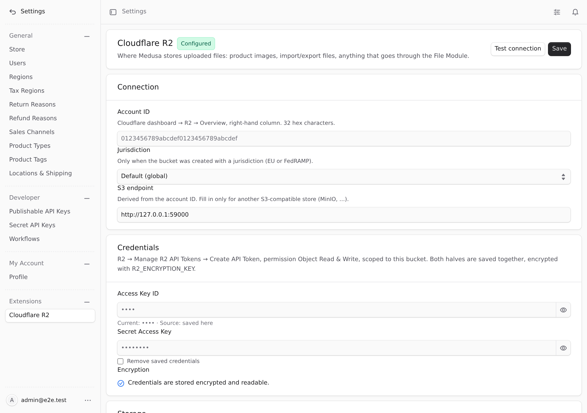
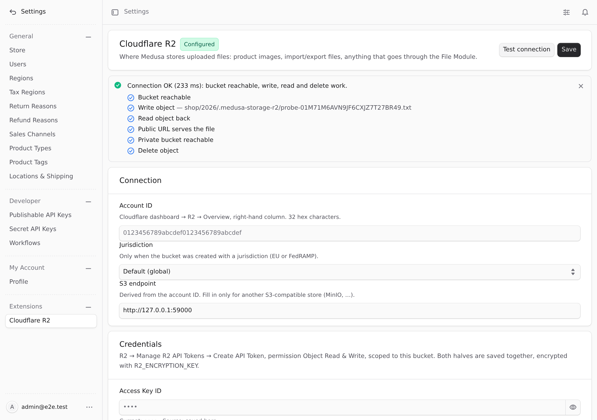

<p align="center">
  <a href="https://hauskayu.com">
    <picture>
      <source media="(prefers-color-scheme: dark)" srcset="docs/logo-dark.svg">
      
    </picture>
  </a>
</p>

# medusa-storage-r2

**Cloudflare R2 file storage for Medusa v2, configured from the Admin: paste the account ID, an R2 API token and
the bucket in Settings → Cloudflare R2, press Test connection, done.** Credentials are stored encrypted, a public
URL or custom domain serves the files, presigned uploads and downloads work, and changes apply without a restart.
Built by Haus Kayu for its own store.
<br>Penyimpanan file Cloudflare R2 untuk Medusa v2, diatur dari Admin: tempel Account ID, token API R2, dan nama
bucket, tes koneksi, selesai. Dibuat oleh Haus Kayu untuk tokonya sendiri.

[](https://www.npmjs.com/package/medusa-storage-r2)
[](https://github.com/haustex/fs-medusa-r2/actions/workflows/ci.yml)
[](https://medusajs.com)
[](LICENSE)

> **Community plugin, not a Cloudflare product.** Independent open source (MIT), not affiliated with or endorsed by
> Cloudflare. Works with any S3-compatible store through a custom endpoint, too.

### Compatibility

| Plugin | Medusa | Node | Tested in CI on |
| --- | --- | --- | --- |
| 0.1.x | 2.19.0 or newer 2.x (`^2.19.0`) | 20.19+ or 22.12+ | Medusa 2.19.0 and 2.22.2 |

### Quick start

```bash
npm install medusa-storage-r2
echo "R2_ENCRYPTION_KEY=$(openssl rand -hex 32)" >> .env   # same value on server and worker
```

```ts
// medusa-config.ts
plugins: [{ resolve: "medusa-storage-r2", options: {} }],
modules: [
  {
    resolve: "@medusajs/medusa/file",
    options: {
      providers: [{ resolve: "medusa-storage-r2/providers/r2", id: "r2", options: {} }],
    },
  },
],
```

```bash
npx medusa db:migrate
```

Then open **Settings → Cloudflare R2** in the Admin, fill in the account ID, access key, secret, bucket and public
URL, press **Test connection**, then **Save**. The next upload goes to R2.
Full steps: [Installation](#installation) · [Cloudflare setup](#cloudflare-setup) · [Configuration](#configuration).

[English](#english) · [Bahasa Indonesia](#bahasa-indonesia)

| Settings page | Connection test |
| --- | --- |
|  |  |

---

## English

### Features

- **File Module provider** `fs_r2_r2` for Cloudflare R2: upload, streamed (multipart) upload, delete, presigned
  download URLs, presigned upload URLs, download stream and buffer: everything Medusa's Admin, import/export and
  your own code use.
- **Configured in the Admin**: account ID, jurisdiction (default / EU / FedRAMP), bucket, public URL, folder prefix,
  optional private bucket, Cache-Control, link lifetimes. No redeploy to change a bucket or rotate a token.
- **Credentials encrypted at rest** (AES-256-GCM, key from `R2_ENCRYPTION_KEY`), shown masked, saved as a pair.
  Fallback order: Admin → provider options → `R2_*` environment variables.
- **Test connection** before saving: HEAD bucket, write a probe object, read it back, fetch it through the public
  URL, HEAD the private bucket, delete the probe. Each step is reported, so "the r2.dev URL is not enabled" or "the
  token lacks write permission" is one line, not a guessing game.
- **Public and private files**: public files get `public_url/key`; files Medusa marks private (exports, imports) go
  to the private bucket and are served through presigned links. Without a private bucket a private file is
  **rejected**, never written to the public bucket.
- **Content type from the bytes** (PNG, JPEG, WebP, AVIF, HEIC, GIF, SVG, PDF, MP4, …), not from what the browser
  claims; `Cache-Control: private, no-store` on private objects; optional size limit.
- **Retries and timeouts** for the transient errors R2 and the network produce (adaptive retry, 4 attempts, 5 s
  connect / 30 s request), never for 4xx.
- **CORS for browser uploads**: Test connection reports whether the Admin origin may upload; **Apply CORS** adds the
  rule, or hands you the policy JSON when the token may not.
- **Change log** of the settings (who, when, which fields; never values) and a command to rotate
  `R2_ENCRYPTION_KEY`.
- **Migration command** from `file-local` (`static/`) or S3 to R2: dry run, per-file verification, CSV report, URL
  rewrite in the database, resume and rollback; sources are never deleted.
- **Cloudflare Image Transformations** (optional): a URL template such as
  `{public_url}/cdn-cgi/image/format=auto,quality=85/{key}` for every public file URL.
- **S3-compatible stores** through a custom endpoint (MinIO, RustFS, Garage, …), which is also how the end-to-end
  tests run; a second suite runs weekly against a real R2 bucket.
- English and Indonesian Admin texts.

### Requirements

- Medusa **2.19 or newer 2.x** (tested in CI on 2.19.0 and 2.22.2), Node 20.19+ or 22.12+.
- A Cloudflare account with R2 enabled and one bucket (two if you want private files kept apart).

### Installation

```bash
npm install medusa-storage-r2
```

`medusa-config.ts`: register the plugin and make it the File Module's provider. Medusa uses one file provider at a
time, so this replaces `@medusajs/medusa/file-local` (or `file-s3`).

```ts
module.exports = defineConfig({
  // …
  plugins: [{ resolve: "medusa-storage-r2", options: {} }],
  modules: [
    {
      resolve: "@medusajs/medusa/file",
      options: {
        providers: [
          {
            resolve: "medusa-storage-r2/providers/r2",
            id: "r2",
            options: {
              // all optional; the Admin settings take precedence
              // account_id, bucket, public_url, prefix, access_key_id, secret_access_key, …
            },
          },
        ],
      },
    },
  ],
})
```

Then run the migration and set the encryption key:

```bash
npx medusa db:migrate
echo "R2_ENCRYPTION_KEY=$(openssl rand -hex 32)" >> .env   # same value on server and worker
```

Until the store is configured, uploads fail with `Cloudflare R2 is not configured (missing: …). Open Settings →
Cloudflare R2 …`; nothing else in Medusa is affected.

> **Note for pnpm without hoisting or a locally linked copy:** the Admin build picks up this plugin's Tailwind classes
> through `require.resolve("medusa-storage-r2/admin")` from `@medusajs/admin-bundler`; if the bundler cannot resolve the package
> (pnpm with `hoist=false`, or a plugin symlinked from outside the project), the plugin's Admin pages lose their layout.
> npm, Yarn and pnpm's defaults are fine; otherwise install from npm (or `npm pack`) next to the bundler, or add
> `hoist-pattern[]=medusa-storage-r2` to `.npmrc`.

### Cloudflare setup

1. **Bucket**: Cloudflare dashboard → R2 → Create bucket. Note the **Account ID** shown on the R2 overview page.
2. **Public access** (so product images have a URL): bucket → Settings → Public access. Either enable the
   `r2.dev` subdomain (development; rate limited) or connect a **custom domain** on your zone (production).
   The resulting `https://pub-….r2.dev` or `https://cdn.your-store.com` is the plugin's **Public URL**.
3. **API token** (least privilege): R2 → Manage R2 API Tokens → Create API Token:
   - Permission **Object Read & Write** (not Admin): the plugin only reads, writes and deletes objects.
   - **Specify bucket(s)**: only the bucket(s) of this store. A token for all buckets is not needed.
   - TTL: forever, or rotate on a schedule (saving a new pair in the Admin takes effect at once).
   - Copy the **Access Key ID** and **Secret Access Key** (the S3 pair, not the Cloudflare API token).
   The only operation that needs **Admin Read & Write** is the **Apply CORS** button; without it the Admin shows the
   policy to paste by hand (see [CORS](#cors-browser-uploads)).
4. Optional **private bucket** for exports and imports: a second bucket **without** public access, same token.

### Configuration

Open **Settings → Cloudflare R2** in the Admin:

| Field | Meaning |
| --- | --- |
| Account ID | 32 hex characters; the S3 endpoint `https://<account>.r2.cloudflarestorage.com` is derived from it. |
| Jurisdiction | `default`, `eu` or `fedramp`: only when the bucket was created with one; changes the endpoint host. |
| S3 endpoint | Fill in only for another S3-compatible store. Overrides account ID + jurisdiction. |
| Access Key ID / Secret | The R2 API token pair. Saved together, encrypted; the Admin shows `••••a1b2`. |
| Bucket | Where public files live. |
| Public URL | `https://pub-….r2.dev` or your custom domain. Without it public files get temporary presigned links and a warning is logged. |
| Public URL template | Optional. `{public_url}` and `{key}` placeholders, e.g. `{public_url}/cdn-cgi/image/format=auto,quality=85/{key}` for [Cloudflare Image Transformations](https://developers.cloudflare.com/images/transform-images/transform-via-url/) on a custom domain. Empty: `{public_url}/{key}`. |
| Folder (prefix) | Optional folder inside the bucket. Keys look like `<prefix>/<name>-<ulid>.<ext>`. |
| Private bucket | Bucket for files Medusa marks private. **Empty: private files are rejected** (never stored in the public bucket). |
| Cache-Control | Stored with every public upload. Default `public, max-age=31536000, immutable` (keys are unique). Private objects always get `private, no-store`. |
| Download / upload links | Lifetime of presigned links in seconds, 60 to 604800 (7 days, the SigV4 maximum). |
| Max file size | Read-only; set with the `max_file_size` provider option (bytes). |

**Test connection** uses the values in the form (saved or not) and writes one probe object under
`<prefix>/.medusa-storage-r2/`, which it deletes again.

Lookup order for every value: Admin → provider `options` → environment:

| Env var | Option | Setting |
| --- | --- | --- |
| `R2_ACCOUNT_ID` | `account_id` | Account ID |
| `R2_JURISDICTION` | `jurisdiction` | Jurisdiction |
| `R2_ENDPOINT` | `endpoint` | S3 endpoint |
| `R2_ACCESS_KEY_ID`, `R2_SECRET_ACCESS_KEY` | `access_key_id`, `secret_access_key` | Credentials (always both from one source) |
| `R2_BUCKET` | `bucket` | Bucket |
| `R2_PUBLIC_URL` | `public_url` | Public URL |
| `R2_PREFIX` | `prefix` | Folder |
| `R2_PRIVATE_BUCKET` | `private_bucket` | Private bucket |
| `R2_PUBLIC_URL_TEMPLATE` | `public_url_template` | Public URL template |
| `R2_CACHE_CONTROL` | `cache_control` | Cache-Control |
| – | `download_url_ttl`, `upload_url_ttl` | Link lifetimes |
| – | `max_file_size` | Largest upload in bytes (buffers and streams); default unlimited |
| – | `max_attempts`, `connection_timeout_ms`, `request_timeout_ms` | Retry/timeout tuning (defaults 4, 5000, 30000). Only 5xx, 429 and network errors are retried. |
| – | `settings_cache_ttl_ms` | How long a process caches the settings (default 60000) |
| `R2_ENCRYPTION_KEY` | – | 64 hex chars (`openssl rand -hex 32`). Needed to store credentials in the Admin. Back it up with the database. |

Settings saved in the Admin reach the other Medusa processes (worker) through the `r2.settings.updated` event and
in any case within `settings_cache_ttl_ms`.

### Private files

Medusa marks some files private (product import/export CSVs, anything your code uploads with `access: "private"`).
They go to the **private bucket** and are only reachable through presigned links (`download_url_ttl`). If no private
bucket is set, such an upload fails with `This file is private … Private files are never written to the public
bucket: set a private bucket in Settings → Cloudflare R2.` This is deliberate: a public bucket serves every key it
holds, and a ULID in the name is not a secret. Private objects are stored with `Cache-Control: private, no-store`.

### CORS (browser uploads)

CORS on the bucket matters only when a browser uploads **straight to R2** through a presigned upload URL
(`POST /admin/uploads/presigned-urls` and then `PUT` from the page). Uploads through the Medusa server never need it.

- **Test connection** includes a `cors` check for the Admin's origin. It is a warning, not a failure.
- **Apply CORS** (Settings → Cloudflare R2 → Browser uploads) adds this rule for the current Admin origin and keeps the
  rules already there. It needs a token with **Admin Read & Write**; with an Object Read & Write token the page shows
  the same policy to paste into Cloudflare → R2 → bucket → Settings → **CORS policy**:

```json
[
  {
    "AllowedOrigins": ["https://admin.your-store.com"],
    "AllowedMethods": ["GET", "HEAD", "PUT"],
    "AllowedHeaders": ["*"],
    "ExposeHeaders": ["ETag"],
    "MaxAgeSeconds": 3600
  }
]
```

### Moving an existing store to R2

Files uploaded before the switch stay where they were (for `file-local`: `static/` on the server) and their URLs
in the database still point there. `migrate-to-r2` copies them into the bucket, verifies every copy and rewrites the
URLs. Options are plain words (`medusa exec` does not accept `--flags`):

```bash
# 1. look first: what would be copied, is every file readable? (no upload, no database change)
npx medusa exec ./node_modules/medusa-storage-r2/.medusa/server/src/scripts/migrate-to-r2.js \
  source=local static-dir=./static base-url=https://api.your-store.com/static dry-run

# 2. copy + verify + rewrite URLs
npx medusa exec ./node_modules/medusa-storage-r2/.medusa/server/src/scripts/migrate-to-r2.js \
  source=local static-dir=./static base-url=https://api.your-store.com/static

# 3. something failed (network, a missing file)? fix it and continue where it stopped
npx medusa exec … base-url=… resume

# 4. undo the URL change (objects in R2 and the source files stay)
npx medusa exec … rollback
```

| Word | Meaning |
| --- | --- |
| `source=local` (default) / `source=s3` | Where the files are now. `s3` reads `MIGRATE_S3_ENDPOINT`, `MIGRATE_S3_BUCKET`, `MIGRATE_S3_ACCESS_KEY_ID`, `MIGRATE_S3_SECRET_ACCESS_KEY`, optional `MIGRATE_S3_REGION`, `MIGRATE_S3_FORCE_PATH_STYLE=0` from the environment. |
| `static-dir=<dir>` | `local`: the folder `file-local` wrote to (default `./static`). |
| `base-url=<url>` | The prefix the stored URLs start with (`file-local`: `<backend URL>/static`). Only URLs under it are migrated. |
| `tables=image.url,product.thumbnail,…` | Columns to scan and rewrite; add your own `<table>.<column>`. Default: the two product image columns. |
| `report=<dir>` | Where the CSV report and `state.json` go (default `./r2-migration`). |
| `dry-run`, `resume`, `rollback`, `rewrite=no` | As above; `rewrite=no` copies and verifies but leaves the database alone. |

Each file is streamed to R2 under `<prefix><path below base-url>` (names unchanged, so a URL maps to one key), its
content type is sniffed, the size on R2 is compared with the bytes read and the MD5 with R2's ETag (single-part
uploads); the SHA-256 is in the report. A URL is rewritten only after its file verified. **Nothing is ever deleted**:
remove `static/` yourself once the store runs fine on R2.

### Next.js storefront

Allow the public host in `next.config`:

```js
images: {
  remotePatterns: [
    { protocol: "https", hostname: "pub-xxxxxxxx.r2.dev" },   // or your custom domain
  ],
},
```

With a URL template for Cloudflare Image Transformations you can also set `images.unoptimized: true` (or a custom
`loader`) and let Cloudflare resize instead of Next.

### Rotating the encryption key

```bash
R2_ENCRYPTION_KEY_OLD=<current key> R2_ENCRYPTION_KEY=$(openssl rand -hex 32) \
  npx medusa exec ./node_modules/medusa-storage-r2/.medusa/server/src/scripts/rotate-encryption-key.js
# then put the new key in .env of every process (server, worker) and restart them
```

The stored access key and secret are decrypted with the old key and re-encrypted with the new one in place; the
change log records the rotation with both key fingerprints (never the keys). A running process with the old key
reports "key mismatch" until it is restarted.

### Troubleshooting

| Symptom | Cause / fix |
| --- | --- |
| Test connection: `bucket` → `HTTP 403` / `SignatureDoesNotMatch` | Wrong secret, or the token is not scoped to this bucket. Create a new token (Object Read & Write, this bucket). |
| Test connection: `bucket` shows a ⚠ "HEAD bucket not permitted" | Normal for an Object Read & Write token: R2 may refuse `HeadBucket`. The probe object then proves the bucket; the test is still OK when write/read/delete pass. |
| `bucket` → `HTTP 404` / `NoSuchBucket` | Bucket name typo, or the bucket lives in another jurisdiction (EU/FedRAMP) than the one selected. |
| `bucket` → `HTTP 400` / `InvalidArgument` | Account ID wrong (the endpoint host is derived from it). |
| `public_url` → `HTTP 404` or `content differs` | Public access is not enabled on the bucket, the Public URL belongs to another bucket, or a custom domain is not active yet. |
| `public_url` → timeout | The r2.dev subdomain is rate limited; use a custom domain in production. |
| `cors` warning | Only matters for presigned browser uploads; see [CORS](#cors-browser-uploads). |
| Upload: `This file is private …` | Set a private bucket. The plugin never puts private files in the public bucket. |
| Upload: `exceeds the limit` | `max_file_size` provider option. |
| `R2_ENCRYPTION_KEY does not match` | The key changed after the credentials were saved: run the rotation command with the old key, or enter the credentials again. |
| `Unsupported checksum` / `x-amz-checksum` errors with another S3 store | The client already sends checksums only `WHEN_REQUIRED`; update the store (MinIO ≥ 2025, RustFS) or report an issue. |
| Images missing after the migration | `base-url` did not match the stored URLs exactly (scheme, host, `/static`); check the CSV report and run again. |

### Plugin options

```ts
plugins: [{ resolve: "medusa-storage-r2", options: { showCredit: true } }]
```

`showCredit` (default `true`) shows the small "by Haus Kayu" line under the settings page.

### FAQ

**Does R2 need ACLs?** No, and the plugin never sends any. Public access is a bucket-level setting in Cloudflare;
the plugin only decides which bucket an object goes to.

**Why does `GET /admin/uploads/:id` return a presigned URL for a public file?** That route always asks the provider
for a presigned download link; product images and other public files keep their plain public URL in the database.

**Can I use it without the Admin page?** Yes: provider options or `R2_*` variables alone configure it. The Admin
page then shows them as read-only hints (`Source: medusa-config.ts`).

**What if I lose `R2_ENCRYPTION_KEY`?** Uploads stop with a clear message, the Admin shows "key mismatch", and you
enter the access key and secret again. Nothing in the bucket is affected.

**Why is the content type sometimes different from what I uploaded?** The plugin looks at the first bytes. A PNG
uploaded as `application/octet-stream` is stored as `image/png`; a `.docx` keeps its declared type (it is a zip
inside). Plain text and unknown formats keep the declared type or fall back to the extension.

**Unicode file names arrive garbled (`é`)** — Medusa's multipart parser decodes names as latin1; the plugin repairs
such names to UTF-8 before building the key.

### Security

- Secrets are never returned by any route or written to logs; the Admin receives `••••` + the last four
  characters of the access key ID only.
- Ciphertext format `v1.<iv>.<tag>.<ciphertext>` (AES-256-GCM, 96-bit IV, the column name as AAD) and a key
  fingerprint next to it, so a changed key is reported instead of producing garbage.
- File names are sanitized (`..`, leading slashes and `.` segments removed) and every stored key carries a ULID.
- All Admin routes require an authenticated Admin user; request bodies are validated with strict schemas.
- Every change to the settings is logged in `r2_setting_event` (user, time, field names, and for CORS the origin);
  values never are. The log is shown on the settings page.
- See [SECURITY.md](SECURITY.md) for reporting and operating guidance.

---

## Bahasa Indonesia

### Fitur

- **Provider File Module** `fs_r2_r2` untuk Cloudflare R2: unggah, unggah streaming (multipart), hapus, tautan
  unduh presigned, tautan unggah presigned, stream dan buffer: semua yang dipakai Admin Medusa, impor/ekspor, dan
  kode Anda sendiri.
- **Diatur dari Admin**: Account ID, yurisdiksi, bucket, URL publik, folder, bucket privat opsional, Cache-Control,
  masa berlaku tautan. Ganti bucket atau rotasi token tanpa deploy ulang.
- **Kredensial terenkripsi** (AES-256-GCM, kunci dari `R2_ENCRYPTION_KEY`), ditampilkan tersamar, disimpan
  berpasangan. Urutan fallback: Admin → opsi provider → environment variable `R2_*`.
- **Tes koneksi** sebelum menyimpan: cek bucket, tulis objek uji, baca ulang, ambil lewat URL publik, cek bucket
  privat, hapus. Tiap langkah dilaporkan terpisah.
- **File publik dan privat**: file publik dapat `public_url/key`; file yang Medusa tandai privat (ekspor, impor)
  masuk ke bucket privat dan dilayani lewat tautan presigned. Tanpa bucket privat, file privat **ditolak**, tidak
  pernah ditulis ke bucket publik.
- **Content type dari isi file** (bukan dari klaim browser), `Cache-Control: private, no-store` untuk objek privat,
  batas ukuran opsional, retry + timeout untuk gangguan sementara (5xx/429/jaringan).
- **CORS untuk unggah dari browser**: tes koneksi melaporkan status CORS, tombol **Terapkan CORS** menambah aturannya
  (atau memberi JSON-nya kalau token tidak berhak).
- **Riwayat perubahan** pengaturan (siapa, kapan, field apa; tanpa nilai) dan perintah rotasi `R2_ENCRYPTION_KEY`.
- **Perintah migrasi** dari `file-local` (`static/`) atau S3 ke R2: dry-run, verifikasi per file, laporan CSV, URL di
  database diperbarui, resume dan rollback; file sumber tidak pernah dihapus.
- **Template URL** opsional untuk Cloudflare Image Transformations (`{public_url}/cdn-cgi/image/…/{key}`).
- Teks Admin dalam Bahasa Indonesia dan Inggris.

### Kebutuhan

- Medusa **2.19 atau 2.x yang lebih baru** (diuji di CI pada 2.19.0 dan 2.22.2), Node 20.19+ atau 22.12+.
- Akun Cloudflare dengan R2 aktif dan satu bucket (dua kalau file privat mau dipisah).

### Pasang

```bash
npm install medusa-storage-r2
```

Di `medusa-config.ts`, daftarkan plugin dan jadikan provider File Module (menggantikan `file-local` / `file-s3`;
Medusa hanya memakai satu provider file):

```ts
plugins: [{ resolve: "medusa-storage-r2", options: {} }],
modules: [
  {
    resolve: "@medusajs/medusa/file",
    options: {
      providers: [{ resolve: "medusa-storage-r2/providers/r2", id: "r2", options: {} }],
    },
  },
],
```

Lalu:

```bash
npx medusa db:migrate
echo "R2_ENCRYPTION_KEY=$(openssl rand -hex 32)" >> .env   # nilai sama di server dan worker
```

> **Catatan untuk pnpm tanpa hoisting atau plugin yang di-symlink lokal:** build Admin mengambil class Tailwind plugin
> ini lewat `require.resolve("medusa-storage-r2/admin")` dari `@medusajs/admin-bundler`; kalau bundler tidak bisa me-resolve paketnya
> (pnpm dengan `hoist=false`, atau plugin di-symlink dari luar proyek), halaman Admin plugin kehilangan layout-nya. npm,
> Yarn, dan pnpm bawaan aman; selain itu pasang dari npm (atau `npm pack`) di sebelah bundler, atau tambahkan
> `hoist-pattern[]=medusa-storage-r2` di `.npmrc`.

### Setup di Cloudflare

1. **Bucket**: dashboard Cloudflare → R2 → Create bucket. Catat **Account ID** di halaman overview R2.
2. **Akses publik**: bucket → Settings → Public access. Aktifkan subdomain `r2.dev` (untuk development, dibatasi
   rate limit) atau hubungkan **custom domain** (produksi). URL yang didapat adalah **URL publik** di plugin.
3. **Token API** (hak seminimal mungkin): R2 → Manage R2 API Tokens → Create API Token, izin **Object Read & Write**
   (bukan Admin), **dibatasi ke bucket** toko ini saja. Salin **Access Key ID** dan **Secret Access Key** (pasangan
   S3, bukan token API Cloudflare). Hanya tombol **Terapkan CORS** yang butuh Admin Read & Write; tanpa itu Admin
   menampilkan JSON kebijakan untuk ditempel manual.
4. **Bucket privat** untuk ekspor/impor: bucket kedua tanpa akses publik, token yang sama. Tanpa ini, file privat
   ditolak (tidak pernah jatuh ke bucket publik).

### Konfigurasi

Buka **Settings → Cloudflare R2** di Admin, isi Account ID, kredensial, bucket, dan URL publik, klik **Tes koneksi**,
lalu **Simpan**. Unggahan berikutnya langsung ke R2, tanpa restart. Arti tiap kolom dan daftar environment variable
ada di bagian [Configuration](#configuration) di atas.

### Pindah dari penyimpanan lokal

File yang diunggah sebelum pindah tetap di `static/` dan URL-nya di database masih menunjuk ke sana. Perintah
`migrate-to-r2` menyalinnya ke bucket, memverifikasi tiap salinan (ukuran + MD5/SHA-256), menulis laporan CSV, dan
memperbarui URL di `image.url` + `product.thumbnail` (tabel lain lewat `tables=`). Jalankan `dry-run` dulu, lalu
tanpa kata itu; `resume` melanjutkan yang gagal, `rollback` mengembalikan URL lama. **File sumber tidak pernah
dihapus.** Detail opsi di bagian [Moving an existing store to R2](#moving-an-existing-store-to-r2).

```bash
npx medusa exec ./node_modules/medusa-storage-r2/.medusa/server/src/scripts/migrate-to-r2.js \
  source=local static-dir=./static base-url=https://api.toko-anda.com/static dry-run
```

Rotasi kunci enkripsi: `R2_ENCRYPTION_KEY_OLD=<lama> R2_ENCRYPTION_KEY=<baru> npx medusa exec
./node_modules/medusa-storage-r2/.medusa/server/src/scripts/rotate-encryption-key.js`, lalu ganti kunci di `.env`
semua proses dan restart.

---

## Development

```bash
npm ci
npm run build
npm run lint && npm run typecheck && npm run test:unit
# E2E (Postgres + RustFS on the spike ports, see CONTRIBUTING.md)
node integration-tests/e2e.mjs
```

### Testing against real R2

CI runs the suite against RustFS on every push and against a **real R2 bucket** weekly and on demand (workflow
"R2 live"). It needs the GitHub Environment `r2-live` (repository → Settings → Environments → New environment):

1. In Cloudflare create a throw-away bucket (e.g. `medusa-storage-r2-ci`), enable its r2.dev public access, and an
   API token with **Object Read & Write** scoped to that bucket only. Optionally a second bucket without public
   access for the private-file checks.
2. In the `r2-live` environment add **secrets** `R2_LIVE_ACCESS_KEY_ID`, `R2_LIVE_SECRET_ACCESS_KEY` and
   **variables** `R2_LIVE_ACCOUNT_ID`, `R2_LIVE_BUCKET`, `R2_LIVE_PUBLIC_URL` (the r2.dev URL), optionally
   `R2_LIVE_PRIVATE_BUCKET`, `R2_LIVE_JURISDICTION`.
3. Actions → R2 live → Run workflow. Without the secrets the job logs a notice and ends as skipped, not failed.

Every run writes under a unique `e2e-<id>/` prefix and deletes it at the end. The bucket's CORS policy is changed
only when the token may do so (an Admin token); with an Object Read & Write token that path is asserted to fail
cleanly. Locally: `R2_E2E_LIVE=1 R2_LIVE_…=… node integration-tests/e2e.mjs`.

## Built for hauskayu.com

[hauskayu.com](https://hauskayu.com), the Haus Kayu store (teak furniture and crafts from Jepara), is moving its product
images and documents from the server's disk to R2 with this plugin, next to its payment and shipping plugins.

## Other plugins by Haus Kayu

- [medusa-payment-doit](https://github.com/haustex/pg-medusa-doit): doit.id payments (QRIS, Virtual Account) for Indonesia.
- [medusa-payment-manual-transfer](https://github.com/haustex/pg-medusa-manual-transfer): manual bank transfer with
  payment-proof upload and admin verification.
- [medusa-fulfillment-zone-rate](https://github.com/haustex/fl-medusa-zone-rate): calculated shipping by zone and
  chargeable weight, with shipment tracking.

## About Haus Kayu

[Haus Kayu](https://hauskayu.com) makes custom teak furniture and wooden crafts in Jepara, Indonesia, and runs its
own store on Medusa. The plugins we need and cannot find, we build and publish.

## Support

- Issues and feature requests: [GitHub issues](https://github.com/haustex/fs-medusa-r2/issues)
- E-mail: [dev@hauskayu.com](mailto:dev@hauskayu.com)

## Disclaimer

This is a community plugin, not a Cloudflare product. Cloudflare and R2 are trademarks of Cloudflare, Inc.; MinIO
and RustFS of their respective owners. Use at your own risk; see the [license](LICENSE).

## Sponsors

This plugin is free and MIT licensed, maintained by a small furniture workshop in Jepara, Indonesia. If it saves you
time, [sponsor Haus Kayu on GitHub](https://github.com/sponsors/haustex).
<br>Plugin ini gratis (MIT) dan dirawat oleh workshop furnitur kecil di Jepara. Kalau plugin ini menghemat waktumu,
[dukung Haus Kayu lewat GitHub Sponsors](https://github.com/sponsors/haustex).

### Business sponsors

_Your logo here. [Become a Business sponsor](https://github.com/sponsors/haustex) ($50/month)._

### Backers

_Your name here. [Become a Backer](https://github.com/sponsors/haustex) ($10/month)._

## License

[MIT](LICENSE) © Haus Kayu
